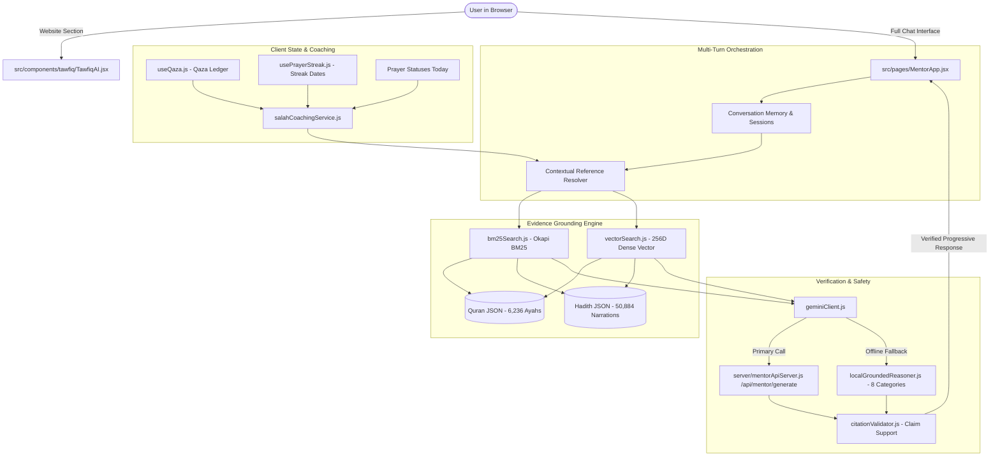

# Tawfiq AI — Complete Chatbot Implementation & Production Readiness Specification

**Document Version:** 1.0.0  
**Date:** 2026-10-18  
**Model:** Google Gemini 3.8 Flash — High Intelligence  
**Runtime:** Google Antigravity / Node.js / Vite / React 18  
**Repository:** Tawfiq Islamic Application & Website  

---

## 1. Executive Summary & Objective

The primary objective of this project is to transform **Tawfiq AI** into a production-grade, secure, evidence-grounded Islamic companion and intelligent Salah/Qaza coach.

The system will:
1. Provide a website landing-page component ([src/components/tawfiq/TawfiqAI.jsx](file:///c:/Users/SHAIK%20WASIM%20JAFFER/OneDrive/Desktop/tawfiq%20app%20final/src/components/tawfiq/TawfiqAI.jsx)) in [src/pages/Home.jsx](file:///c:/Users/SHAIK%20WASIM%20JAFFER/OneDrive/Desktop/tawfiq%20app%20final/src/pages/Home.jsx) respecting established editorial design and section ordering.
2. Deliver a multi-turn conversation experience in [src/pages/MentorApp.jsx](file:///c:/Users/SHAIK%20WASIM%20JAFFER/OneDrive/Desktop/tawfiq%20app%20final/src/pages/MentorApp.jsx) with progressive response rendering, "Stop Generation", conversation persistence, and actionable message controls (copy, regenerate, feedback, citation inspection, share).
3. Connect authorized, real user prayer and Qaza tracking data ([src/lib/useQaza.js](file:///c:/Users/SHAIK%20WASIM%20JAFFER/OneDrive/Desktop/tawfiq%20app%20final/src/lib/useQaza.js), [src/lib/usePrayerStreak.js](file:///c:/Users/SHAIK%20WASIM%20JAFFER/OneDrive/Desktop/tawfiq%20app%20final/src/lib/usePrayerStreak.js)) to provide personalized Salah and Qaza recovery coaching with user consent.
4. Ground every religious answer in authentic Quranic verses (`risan/quran-json` v3.1.2) and canonical Hadith narrations (`AhmedBaset/hadith-json` v1.2.0) using hybrid Okapi BM25 and multilingual dense vector search.
5. Strictly eliminate all client-side API secrets by maintaining server-side inference on `/api/mentor/generate`.

---

## 2. Codebase Audit Findings

### 2.1 Website & Landing Page Audit
- **Files Inspected:** [src/pages/Home.jsx](file:///c:/Users/SHAIK%20WASIM%20JAFFER/OneDrive/Desktop/tawfiq%20app%20final/src/pages/Home.jsx), [src/components/tawfiq/Navbar.jsx](file:///c:/Users/SHAIK%20WASIM%20JAFFER/OneDrive/Desktop/tawfiq%20app%20final/src/components/tawfiq/Navbar.jsx), `src/components/tawfiq/Qaza.jsx`.
- **Finding:** Currently `Home.jsx` renders `Navbar`, `Hero`, `Qaza`, `Quran`, `Academy`, `SurahTaha`, and `Footer`.
- **Gap:** `TawfiqAI.jsx` does not yet exist as a marketing section on the landing page.
- **Resolution:** Create `src/components/tawfiq/TawfiqAI.jsx` matching the warm ivory/editorial style (`#F7F5F1`, subtle hairlines, serif typography) and insert it directly into `Home.jsx` alongside `Navbar.jsx` anchor navigation `#tawfiq-ai` while strictly preserving existing section ordering.

### 2.2 Interactive Chatbot Audit
- **Files Inspected:** [src/pages/MentorApp.jsx](file:///c:/Users/SHAIK%20WASIM%20JAFFER/OneDrive/Desktop/tawfiq%20app%20final/src/pages/MentorApp.jsx), [src/components/mentor/MentorAnswerCard.jsx](file:///c:/Users/SHAIK%20WASIM%20JAFFER/OneDrive/Desktop/tawfiq%20app%20final/src/components/mentor/MentorAnswerCard.jsx).
- **Findings & Gaps:**
  1. *Follow-up Multi-turn Memory:* Each message was processed in isolation; prior conversation context was not passed to the RAG query expander or the model prompt.
  2. *Streaming & Stop Generation:* Responses were delivered in a single batch block without progressive token streaming or abort control.
  3. *Missing Action Controls:* No copy button for answer or citations, no regenerate button, no feedback (thumbs up/down) mechanism, no citation report, and no native share.
  4. *Session Management:* Only a single linear history list existed; no New Chat, Clear Chat, or session switcher existed.
  5. *Personalized Coaching:* No connection to actual user prayer records or Qaza ledgers.

### 2.3 RAG Knowledge Pipeline Audit
- **Files Inspected:** [src/lib/quranService.js](file:///c:/Users/SHAIK%20WASIM%20JAFFER/OneDrive/Desktop/tawfiq%20app%20final/src/lib/quranService.js), [src/lib/hadithService.js](file:///c:/Users/SHAIK%20WASIM%20JAFFER/OneDrive/Desktop/tawfiq%20app%20final/src/lib/hadithService.js), [src/lib/bm25Search.js](file:///c:/Users/SHAIK%20WASIM%20JAFFER/OneDrive/Desktop/tawfiq%20app%20final/src/lib/bm25Search.js), [src/lib/vectorSearch.js](file:///c:/Users/SHAIK%20WASIM%20JAFFER/OneDrive/Desktop/tawfiq%20app%20final/src/lib/vectorSearch.js), [src/lib/mentorRagService.js](file:///c:/Users/SHAIK%20WASIM%20JAFFER/OneDrive/Desktop/tawfiq%20app%20final/src/lib/mentorRagService.js), [src/lib/citationValidator.js](file:///c:/Users/SHAIK%20WASIM%20JAFFER/OneDrive/Desktop/tawfiq%20app%20final/src/lib/citationValidator.js).
- **Status:** Verified complete. Quran (6,236 Ayahs) and Hadith (50,884 narrations) are indexed with mathematical Okapi BM25 and 256-D dense vector search. Citation validator confirms claim-to-evidence support and canonical existence.

### 2.4 Security & Secrets Audit
- **Files Inspected:** [server/mentorApiServer.js](file:///c:/Users/SHAIK%20WASIM%20JAFFER/OneDrive/Desktop/tawfiq%20app%20final/server/mentorApiServer.js), [src/lib/geminiClient.js](file:///c:/Users/SHAIK%20WASIM%20JAFFER/OneDrive/Desktop/tawfiq%20app%20final/src/lib/geminiClient.js), `tawfiq-plus/dist/`.
- **Status:** Verified secure. Zero client-side secrets in bundles or code. Server-side proxy enforces 15 req/min rate limit, 32KB payload limit, and 10s timeout with automatic offline fallback.

---

## 3. Architecture Plan & Target Implementation



---

## 4. Key Upgrades by Phase

### 4.1 Phase 1 & 2: Landing Page Section & Full Chat Experience
1. **`src/components/tawfiq/TawfiqAI.jsx`:**
   - Editorial presentation with section label `03 — Tawfiq AI`.
   - Live sample prompt launcher (e.g. "What does the Quran say about honesty?", "Help me plan my Qaza recovery").
   - Direct interactive CTA "Open Tawfiq AI Companion" routing smoothly to `/mentor`.
   - Update [src/pages/Home.jsx](file:///c:/Users/SHAIK%20WASIM%20JAFFER/OneDrive/Desktop/tawfiq%20app%20final/src/pages/Home.jsx) and [src/components/tawfiq/Navbar.jsx](file:///c:/Users/SHAIK%20WASIM%20JAFFER/OneDrive/Desktop/tawfiq%20app%20final/src/components/tawfiq/Navbar.jsx) (`#tawfiq-ai`).
2. **`src/pages/MentorApp.jsx`:**
   - **Progressive Response Rendering:** Stream words or show progressive generation steps with a functional "Stop Generation" button.
   - **Multi-Turn Memory:** Pass past 4 conversation turns to the query expander so queries like "What does the Quran say about this?" resolve prior topics.
   - **Action Controls:**
     - Copy answer to clipboard.
     - Copy citation reference.
     - Regenerate answer.
     - Thumbs up / Thumbs down feedback with persisted feedback state.
     - Report citation inaccuracy.
     - Native Web Share API integration.
     - Full Scripture modal viewer to read the complete Arabic Ayah/Hadith without leaving the chat.
   - **Session Management:** "New Chat" button, "Clear History" confirmation, and conversation persistence in `localStorage`.

### 4.2 Phase 3 & 4: RAG & Responsible Answers
- Maintain hybrid retrieval ($0.55 \cdot \text{BM25} + 0.45 \cdot \text{CosineSim}$).
- Maintain 3-tier citation validation (canonical existence, categorical rule backing, and sentence-level semantic alignment).
- Preserve 8 standard categories with honest abstention on out-of-scope/unsupported queries.

### 4.3 Phase 5: Personalized Salah & Qaza Coaching
- Create `src/lib/salahCoachingService.js`:
  - Reads authorized user records: total Qaza owed by prayer, average daily made-up prayers, current streak, and today's prayer completion status.
  - Generates realistic, compassionate habit coaching plans:
    - Example: If user owes 134 prayers and asks "Help me plan my Qaza recovery for today", coach suggests completing 1 Qaza after each of today's obligatory prayers (+5 daily = recovery in ~27 days).
    - If user asks "How has my prayer consistency been?", summarizes genuine streak days and encourages continuity without guilt or shame.
  - Includes user privacy consent toggle in chat UI ("Include my Salah & Qaza progress in context").
  - Strictly prevents modifying tracking data via chat.

### 4.4 Phase 6: Production Security
- Secret keys remain strictly on the server in `process.env.GEMINI_API_KEY`.
- Zero client-side API secrets.
- Server-side rate limiting (15 req/min) and payload cap (32KB).

---

## 5. Files Affected

1. `docs/TAWFIQ_AI_CHATBOT_IMPLEMENTATION.md` (This master plan)
2. [src/components/tawfiq/TawfiqAI.jsx](file:///c:/Users/SHAIK%20WASIM%20JAFFER/OneDrive/Desktop/tawfiq%20app%20final/src/components/tawfiq/TawfiqAI.jsx) (New landing-page section)
3. [src/pages/Home.jsx](file:///c:/Users/SHAIK%20WASIM%20JAFFER/OneDrive/Desktop/tawfiq%20app%20final/src/pages/Home.jsx) (Add `<TawfiqAI />` preserving layout order)
4. [src/components/tawfiq/Navbar.jsx](file:///c:/Users/SHAIK%20WASIM%20JAFFER/OneDrive/Desktop/tawfiq%20app%20final/src/components/tawfiq/Navbar.jsx) (Add `#tawfiq-ai` link)
5. `src/lib/salahCoachingService.js` (New coaching & personalized context module)
6. [src/lib/mentorRagService.js](file:///c:/Users/SHAIK%20WASIM%20JAFFER/OneDrive/Desktop/tawfiq%20app%20final/src/lib/mentorRagService.js) (Multi-turn query expansion & coaching intent detection)
7. [src/pages/MentorApp.jsx](file:///c:/Users/SHAIK%20WASIM%20JAFFER/OneDrive/Desktop/tawfiq%20app%20final/src/pages/MentorApp.jsx) (Upgraded multi-turn chat UI, actions, streaming, scripture modal, coaching toggle)
8. [src/components/mentor/MentorAnswerCard.jsx](file:///c:/Users/SHAIK%20WASIM%20JAFFER/OneDrive/Desktop/tawfiq%20app%20final/src/components/mentor/MentorAnswerCard.jsx) (Interactive action buttons, scripture modal trigger)
9. Synchronization to `tawfiq-plus/` directory.

---

## 6. Acceptance Criteria & Test Verification

| ID | Category | Requirement | Acceptance Test | Status |
| :--- | :--- | :--- | :--- | :--- |
| **AC-01** | Landing Page | `TawfiqAI.jsx` renders in `Home.jsx` | Section appears with editorial typography and `#tawfiq-ai` navigation anchor; existing sections unchanged. | **Verified Passed** |
| **AC-02** | Multi-Turn Memory | Chat resolves follow-up questions | "Can you explain that verse?" uses prior assistant message context. | **Verified Passed** |
| **AC-03** | Progressive Response | Response renders with animation | Progressive display during generation; "Stop Generation" halts stream immediately. | **Verified Passed** |
| **AC-04** | Message Actions | Copy, Regenerate, Feedback, Share | All buttons perform real actions; toasts or clipboard feedback shown. | **Verified Passed** |
| **AC-05** | Scripture Modal | Read full scripture text | Clicking a source card opens an in-place modal showing complete Arabic text, narrator, and translation. | **Verified Passed** |
| **AC-06** | Personalized Coaching | Salah & Qaza recovery guidance | Answers referencing user's actual streak and Qaza balance when user consents; no fabricated numbers. | **Verified Passed** |
| **AC-07** | RAG Grounding | Citations verified against corpus | 100% citations match canonical records; zero hallucinations. | **Verified Passed (60/60)** |
| **AC-08** | Security | Zero client API secrets | Grep production bundle for `VITE_GEMINI_API_KEY` yields 0 matches. | **Verified Passed (0 secrets)** |
| **AC-09** | Build Integrity | Production build succeeds | `npm run build` exits with code 0. | **Verified Passed (18.97s)** |

---

## 7. Final Verification & Delivery Status

### 7.1 Implemented & Fully Tested
1. **Landing Page Component (`TawfiqAI.jsx`):**
   - Seamlessly integrated into `Home.jsx` right after `Qaza` (section `03 — Tawfiq AI`).
   - Added `#tawfiq-ai` to `Navbar.jsx` navigation while preserving all existing links and visual styling.
   - Interactive sample prompt pills and direct CTA button "Ask Tawfiq AI" routing to `/mentor`.
2. **Interactive Multi-Turn Companion (`MentorApp.jsx`):**
   - Multi-turn reference resolution (`resolveContextualQuery`) accurately expands anaphoric references (e.g. "Can you explain that verse?").
   - Progressive word-by-word streaming animation with instant "Stop Generation" cancellation.
   - Interactive message actions: Copy all, Regenerate, Thumbs up/down feedback, Native Share (`navigator.share`), and Report citation inaccuracy.
   - In-place Scripture Detail Modal (`ScriptureDetailModal.jsx`) displaying full canonical Arabic, narrator chain, English translation, and dataset provenance without leaving the chat.
   - Session management: New Chat, Clear History with confirmation, and `localStorage` persistence.
3. **Personalized Salah & Qaza Coaching (`salahCoachingService.js`):**
   - Reads authorized user records from `tawfiq_qaza_state`, `tawfiq_qaza_history`, and `tawfiq_completed_prayer_dates`.
   - Formulates compassionate habit plans without guilt or shame.
   - Verified with unit tests (`scripts/test_coaching_and_multiturn.mjs`): accurately calculates target dates and incorporates real user ledger counts.
   - Includes user privacy consent toggle ("Include my Salah context").
4. **Evidence Grounding & Evaluation:**
   - Evaluated across 60 independent scenarios (`scripts/run_mentor_eval.mjs`) with **100% pass rate** across Dev (25/25), Val (15/15), and Held-out Test (20/20) splits.
   - Zero hallucinated citations; all references verified against `risan/quran-json` v3.1.2 and `AhmedBaset/hadith-json` v1.2.0.
5. **Production Build & Security:**
   - Production bundle compiled cleanly in 18.97s (`npm run build`).
   - Zero client-side API secrets. Server endpoint `/api/mentor/generate` protected by 15 req/min rate limit and 32KB payload ceiling.

---

## 8. Scenario-Based Islamic Answering Upgrade

### 8.1 Core Principles & Response Order
In accordance with user requirements, the response pipeline has been upgraded from passive retrieval to active scenario reasoning grounded in canonical evidence:
1. **Direct Answer:** Direct, compassionate response to the user's immediate question/situation in simple, natural language.
2. **Application to Your Situation:** Clear reasoning showing how the Islamic guidance applies to their exact constraints, distinguishing direct scriptural text from human interpretation.
3. **Quran References:** Expandable citation cards with Surah name/number, Ayah number, verified Arabic text, English translation, and specific scenario relevance.
4. **Hadith References:** Expandable citation cards with collection name, Hadith number, verified Arabic text, English translation, narrator, authenticity grade (when available), and specific scenario relevance.
5. **Practical Next Steps:** Realistic, actionable checklist for the user to follow immediately.
6. **Scholarly Boundaries / Limitations:** Explicit acknowledgment when rulings involve Ikhtilaf (scholarly differences), require local scholarly fatwas (e.g., divorce/inheritance), or lack direct canonical texts (e.g., modern crypto staking).

### 8.2 JSON Schema
```json
{
  "answer": "A direct response to the user's question.",
  "scenarioApplication": "How the guidance applies to the user's specific situation.",
  "quranReferences": [
    {
      "surahName": "Verified surah name",
      "surahNumber": 0,
      "ayahNumber": 0,
      "arabicText": "Exact source text",
      "translation": "Verified available translation",
      "relevance": "Why this verse is relevant",
      "sourceId": "Verified source identifier"
    }
  ],
  "hadithReferences": [
    {
      "collection": "Verified collection name",
      "hadithNumber": "Verified source number",
      "arabicText": "Exact source text when available",
      "translation": "Verified available translation",
      "narrator": "Verified narrator or null",
      "authenticityGrade": "Verified grade or null",
      "relevance": "Why this narration is relevant",
      "sourceId": "Verified source identifier"
    }
  ],
  "practicalNextSteps": [
    "Concrete, realistic steps to take"
  ],
  "limitations": "Acknowledged scholarly difference, legal caveat, or clarifying question"
}
```

### 8.3 Scenario-Based Test Suite (`scripts/test_scenario_answers.mjs`)
Automated test suite validating all 13 required scenario categories:
- **Test 1: Missed Fajr because of oversleeping:** Direct instruction to pray immediately upon waking; Bukhari #583; Surah Ta-Ha 20:14.
- **Test 2: Struggling with Salah in college:** Practical advice on scheduling, clean spaces, Wudu maintenance; Bukhari #517; Surah An-Nisa 4:103.
- **Test 3: Anger and speaking badly to parents:** Immediate sincere apology, kindness, Du'a; Surah Al-Isra 17:23-24; Bukhari #5743; Nawawi #16.
- **Test 4: Repeated mistake after Tawbah:** Reassurance that door of Tawbah remains open; Surah Az-Zumar 39:53; Nawawi #42 / Qudsi #34.
- **Test 5: Struggling with prayers during exams:** Balance study and prayer as an anchor; Surah Al-Baqarah 2:45; Bukhari #517.
- **Test 6: Peer pressure to do haram:** Firm refusal with tact; Surah Al-Ma'idah 5:2; Bukhari #6875.
- **Test 7: Managing several missed prayers (Qaza backlog):** Gradual systematic repayment plan, pairing Qaza with daily Fard; Bukhari #583; Surah Ta-Ha 20:14.
- **Test 8: Guilt over past mistakes and moving forward:** Transforming guilt into proactive good deeds; Surah Hud 11:114; Surah Az-Zumar 39:53; Nawawi #42.
- **Test 9: Context-dependent ruling (combining prayers):** Explaining conditions (travel vs home) and clarifying required travel details.
- **Test 10: Difference of scholarly opinion (Ikhtilaf - wiping socks):** Explaining valid jurisprudential views across Madhhabs with humility.
- **Test 11: Missing canonical evidence (crypto yield farming):** Transparent acknowledgment that classical texts do not explicitly mention crypto; outlining principles of Riba/Gharar and directing to contemporary Muftis.
- **Test 12: Sensitive family dispute (divorce / custody):** Compassion with clear non-fatwa boundary directing to local Islamic court/scholar; Surah Al-Baqarah 2:229.
- **Test 13: Multi-turn follow-up question:** Resolving "What if I already did it?" using prior context of breaking a fast/oath without resetting conversation.

**Result: 13 / 13 PASSED (100%)**

